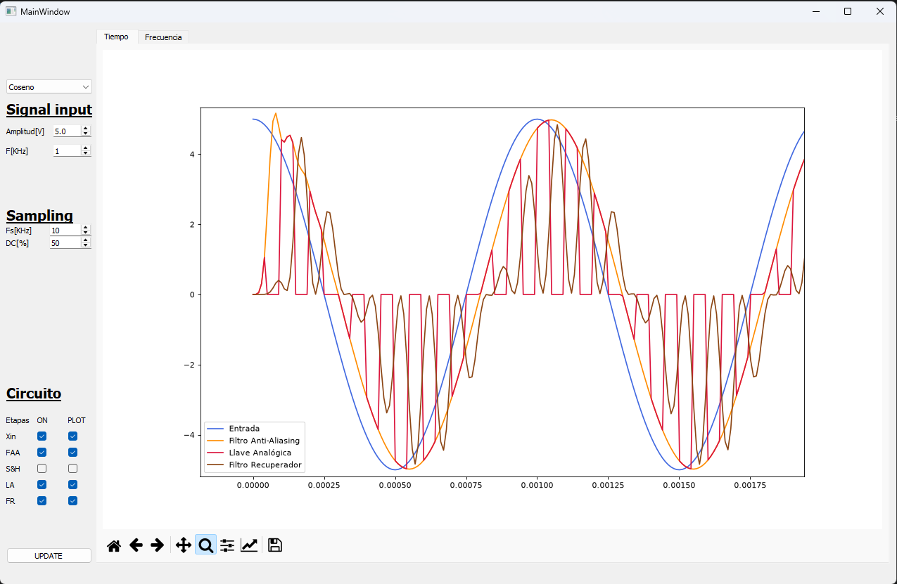
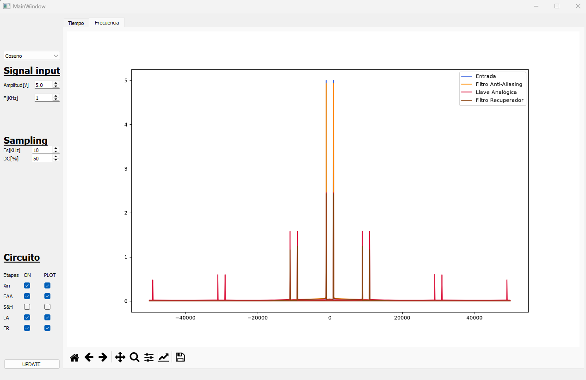
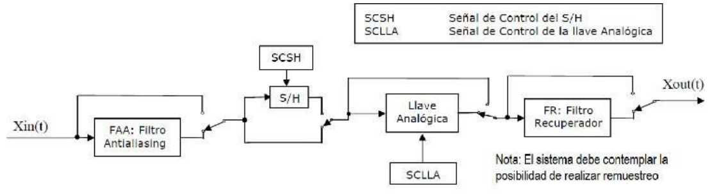
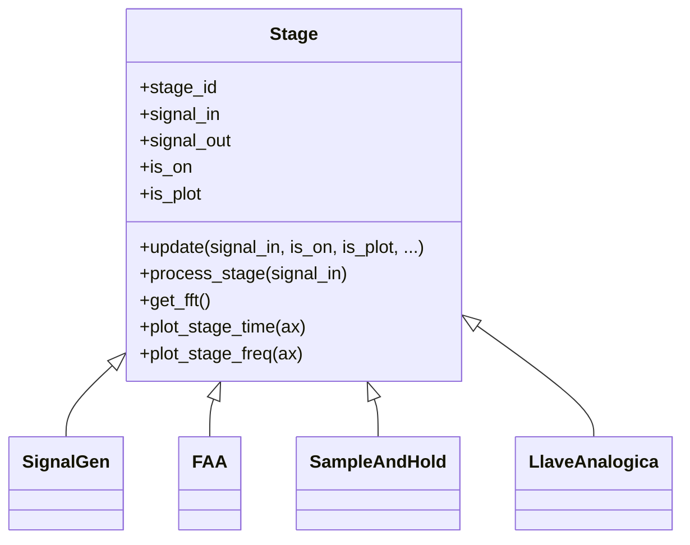

<div align="center">

# 📡 ASSD · TP1 — Simulador de Muestreo y Recuperación de Señales

**Aplicación de escritorio que simula, etapa por etapa, la cadena completa de muestreo de una señal analógica y su posterior reconstrucción.**


*Trabajo Práctico N.º 1 — Análisis de Sistemas y Señales Digitales (ASSD)*

</div>

---

## 📖 Sobre el proyecto

Muestrear una señal no es solo "tomar valores cada cierto tiempo": entran en juego el **aliasing**, el efecto del **sample & hold**, el **duty cycle** de la llave de muestreo y la capacidad de un filtro para **recuperar** la señal original.

Este simulador modela cada uno de esos bloques como una etapa independiente. Permite **activar o puentear** cualquiera de ellas y ver el resultado **en el tiempo y en la frecuencia (FFT)**, todo en una misma interfaz gráfica.

### ✨ Características

- 🎛️ **5 señales de entrada**: coseno, seno, seno de 1,5 períodos repetido, exponencial periódica y una señal tipo AM.
- 🔌 **Cada etapa se puede activar o puentear** para analizar su efecto por separado.
- 📈 **Doble visualización**: dominio del tiempo y espectro de frecuencias, con barra de navegación de matplotlib (zoom, pan y exportar).
- 🧮 **Filtros modelados con componentes reales**: celdas Sallen-Key definidas por sus resistencias y capacitores, no por una transferencia ideal.
- 🧩 **Arquitectura extensible**: todas las etapas heredan de una clase base común (`Stage`).

---

## 📸 Capturas

<p align="center">
  
  <br/>
  <sub><b>Dominio del tiempo</b>: coseno de 1 kHz, la salida del FAA, la señal recortada por la llave analógica y la salida del filtro recuperador.</sub>
</p>

<p align="center">
  
  <br/>
  <sub><b>Dominio de la frecuencia</b>: la componente en 1 kHz y sus réplicas alrededor de múltiplos de <i>fs</i> (9/11 kHz, 29/31 kHz…).</sub>
</p>

<p align="center"><sub>Configuración: Coseno · A = 5 V · f = 1 kHz · fs = 10 kHz · DC = 50 %</sub></p>

---

## 🔗 Cadena de procesamiento

<p align="center">
  
  <br/>
  <sub>Diagrama de bloques de la consigna. Cada etapa tiene una llave de <b>bypass</b>, y el S&H y la llave analógica se controlan con sus propias señales de control (<b>SCSH</b> y <b>SCLLA</b>).</sub>
</p>

En el simulador, cada llave de bypass corresponde al checkbox **ON** de su etapa, y las señales de control se generan a partir de **fs** y del **duty cycle**:


Los colores coinciden con los que usa la aplicación para graficar cada etapa.

| Etapa | Descripción |
|:--|:--|
| **Xin** — Generador | Genera 10 períodos de la señal elegida, con amplitud y frecuencia configurables. |
| **FAA** — Anti-Aliasing | Pasabajos de **8.º orden** (aproximación de **Legendre**), implementado como 4 celdas **Sallen-Key** en cascada y simulado con `scipy.signal.lsim`. |
| **S&H** — Sample & Hold | Toma una muestra cada `1/fs` y la retiene hasta la siguiente. |
| **LA** — Llave Analógica | Multiplica la señal por una onda cuadrada de frecuencia `fs` y duty cycle `DC %`. |
| **FR** — Recuperador | Filtro pasabajos que reconstruye la señal continua a partir de la señal muestreada. |

<details>
<summary><b>🔬 Detalle del filtro Sallen-Key</b></summary>

<br/>

Cada celda tiene la transferencia de un pasabajos Sallen-Key de ganancia unitaria:

$$H(s) = \frac{\dfrac{1}{R_1 R_2 C_1 C_2}}{s^2 + \left(\dfrac{1}{R_2 C_1} + \dfrac{1}{R_1 C_1}\right)s + \dfrac{1}{R_1 R_2 C_1 C_2}}$$

| Celda | R₁ | R₂ | C₁ | C₂ | f₀ ≈ |
|:-:|:-:|:-:|:-:|:-:|:-:|
| 1 | 16 kΩ | 6,8 kΩ | 1 nF | 668 pF | 18,7 kHz |
| 2 | 43 kΩ | 12 kΩ | 1 nF | 150 pF | 18,1 kHz |
| 3 | 12 kΩ | 4,3 kΩ | 10 nF | 150 pF | 18,1 kHz |
| 4 | 12 kΩ | 12 kΩ | 1 nF | 1 nF | 13,3 kHz |

</details>

<details>
<summary><b>🎵 Señales de entrada disponibles</b></summary>

<br/>

| Señal | Definición |
|:--|:--|
| `Coseno` | $A\cos(2\pi f t)$ |
| `Seno` | $A\sin(2\pi f t)$ |
| `SenoXB` | Seno de 1,5 períodos ($1{,}5\,T$) repetido periódicamente |
| `ExpoXB` | $A\,e^{-5f\lvert t\rvert}$ con $t \in [-T, T]$, repetida cada $2T$ |
| `AM` | $A\left[\tfrac12\cos(2\pi\,1{,}8f\,t) + \cos(2\pi\,2f\,t) + \tfrac12\cos(2\pi\,2{,}2f\,t)\right]$ |

</details>

---

## 🚀 Instalación y uso

### Requisitos

- Python **3.7** o superior

### Pasos

```bash
# 1. Clonar el repositorio
git clone https://github.com/cutignolai/ASSD-TP1.git
cd ASSD-TP1

# 2. (Opcional) Crear un entorno virtual
python -m venv venv
venv\Scripts\activate          # Windows
# source venv/bin/activate     # Linux / macOS

# 3. Instalar dependencias
pip install PyQt5 numpy scipy matplotlib

# 4. Ejecutar
python main.py
```

### 🖱️ Cómo usarlo

1. En **Signal input**, elegí el tipo de señal, la **amplitud [V]** y la **frecuencia [kHz]**.
2. En **Sampling**, configurá la **frecuencia de muestreo fs [kHz]** y el **duty cycle [%]** de la llave analógica.
3. En **Circuito**, marcá qué etapas están activas (**ON**) y cuáles querés ver (**PLOT**).
4. Presioná **UPDATE** y alterná entre las pestañas **Tiempo** y **Frecuencia**.

> 💡 **Experimento sugerido:** apagá el FAA, usá una `fs` menor que el doble de la frecuencia de la señal y observá el aliasing en el espectro. Después volvé a encender el filtro y compará.

---

## 🏗️ Arquitectura

```
ASSD-TP1/
├── main.py                  # Punto de entrada
├── template.py              # Ventana principal: arma la cadena y grafica
├── backend/
│   ├── Stage.py             # Clase base: bypass, FFT y ploteo
│   ├── Signal.py            # Generador de señales (Xin)
│   ├── FAA.py               # Filtro Sallen-Key de 8.º orden (FAA / FR)
│   ├── SampleAndHold.py     # Sample & Hold
│   └── LlaveAnalogica.py    # Llave analógica con duty cycle
├── frontend/
│   ├── front.ui             # Diseño de la interfaz (Qt Designer)
│   └── front.py             # Código generado con pyuic5
└── test/                    # Scripts de prueba visual de cada etapa
```

Todas las etapas heredan de **`Stage`**, que resuelve el comportamiento común:



Para agregar una etapa nueva, alcanza con heredar de `Stage` y sobrecargar `process_stage()`:

```python
from backend.Stage import Stage, StageIDs

class MiEtapa(Stage):
    def __init__(self):
        super().__init__(StageIDs.FAA)

    def process_stage(self, signal_in):
        t, x = signal_in
        self.signal_out = [t, 2 * x]   # procesamiento de ejemplo
        return True
```

---

## 🧪 Pruebas

La carpeta [`test/`](test/) tiene scripts que ejercitan cada etapa por separado y grafican su entrada y su salida en tiempo y frecuencia:

```bash
python -m test.test_FAA
python -m test.test_SH
python -m test.test_LlaveAnalogica
python -m test.test_Signal
python -m test.test_stage
python -m test.test_filter
```

---

## 🛣️ Próximos pasos

- [ ] Agregar `requirements.txt`
- [ ] Mostrar solo el semieje positivo de frecuencias en la FFT
- [ ] Convertir los scripts de prueba en tests automáticos con `pytest`

---

## 👤 Autor

<table>
  <tr>
    <td align="center">
      <a href="https://github.com/cutignolai">
        <br/>
        <sub><b>@cutignolai</b></sub>
      </a>
    </td>
  </tr>
</table>

---

<div align="center">

Hecho con 📐 y ☕ para **ASSD**

</div>
